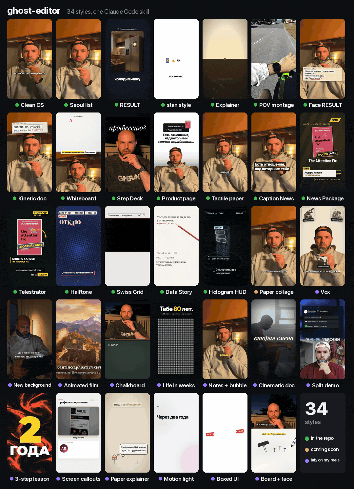
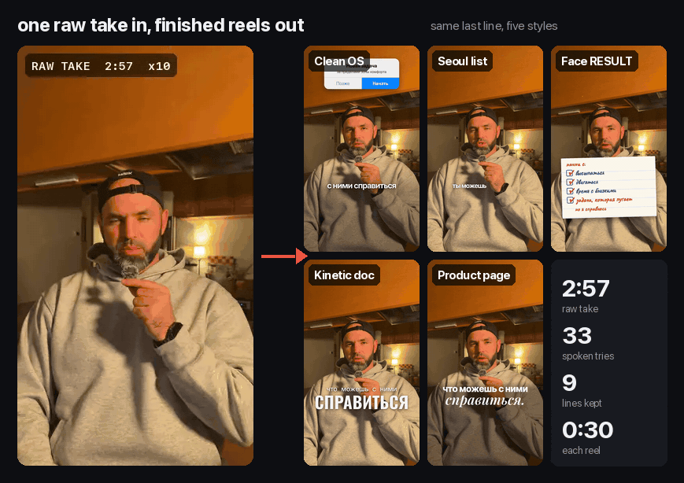
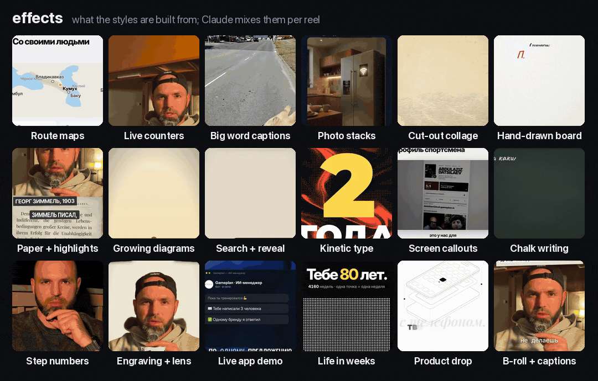

<div align="center">

<h1>ghost-editor</h1>

<p><b>Three minutes of you stumbling through a script in.<br>A 30-second reel that looks paid-for out.</b></p>

<p>Open-source AI video editor for talking-head reels. A Claude Code skill that renders on your Mac.</p>

[](https://github.com/kurbaitaev/ghost-editor/stargazers)
[](LICENSE)
[](https://x.com/kurbaitaev)



<sub>green: in the repo today &nbsp;·&nbsp; orange: coming soon &nbsp;·&nbsp; purple: lab, tried on my own reels</sub>

</div>

## Raw take in, reels out





<p align="center"><sub>FROM MY LAST BATCH: <b>21 reels in 3 h 40 min</b> on one Mac mini · <b>2 of its own mistakes caught</b> before delivery</sub></p>

## Effects



## I paid an editor once

Same raw recording. The human edit on the left, ghost-editor on the right.

https://github.com/user-attachments/assets/312f6910-a8a0-4424-9dd4-612cd079a2e7

## Install

Paste into [Claude Code](https://claude.com/claude-code):

```text
Install the ghost-editor skill: clone https://github.com/kurbaitaev/ghost-editor into ~/.claude/skills/ghost-editor and follow its docs/INSTALL.md.
```

Then:

> Edit ~/Downloads/my-video.mov into a reel in Clean OS.

> Make my video look like this reel: ~/Downloads/reel-i-love.mp4

<details>
<summary><b>Styles you can ask for today</b></summary>

| ask | you get |
|---|---|
| `edit this in Clean OS` | an Apple-ad talking head that lives inside your phone |
| `make a Seoul list` | a voice-over list over fast B-roll and white collage pages |
| `edit this in RESULT style` | a warm podcast edit with navy cards and polaroids |
| `edit this in stan style` | a tool tutorial with your screen behind your head |
| `make an animated explainer` | no camera: a narrator and a world that draws itself |
| `cut these POV clips into a reel` | smart-glasses or GoPro clips cut into a story |
| `edit this in Face RESULT` | RESULT around your face: paper props, polaroids and quote cards beside you, never on you |
| `make a kinetic doc` | a black-and-white archive documentary with one red accent, words popping on as you say them |
| `edit this in Whiteboard` | a split screen: a marker board above draws each thought live, you below |
| `make a Step Deck` | a numbered tips deck: giant italic numerals, word cards and prints cut between your face |
| `edit this as a Product page` | a tool review laid out like a product page: real pictures, rebuilt UI, hairline drawings |
| `edit this in Tactile paper` | your talk on printed paper that moves like stop-motion, with real page folds |
| `edit this in Caption News` | big chunked captions, the keyword on a yellow block, source tags |
| `make a News Package` | you as the anchor of a TV news segment |
| `edit this in Telestrator` | freeze the frame and draw on it like a sports replay |
| `make a Halftone Dossier` | a retro printed case file |
| `edit this in Swiss Grid` | a strict grid poster with one red |
| `make a Data Story` | pencil charts of real, sourced numbers |
| `edit this in Hologram HUD` | a wireframe scan with target boxes |
| `edit mine like this reel` | it studies a reel you love and edits yours the same way |

Plus seven one-word presets: `clean`, `editorial`, `meme`, `cinematic`, `launch`, `kinetic`, `pop`.
</details>

<details>
<summary><b>What you need</b></summary>

- [Claude Code](https://claude.com/claude-code) on a paid Claude plan. ghost-editor itself is free.
- A Mac with Apple silicon. Linux and Intel Macs are untested.
- About 4 GB of disk; the install sets up ffmpeg, Node, Python, Whisper and OpenCV.
- A free [Gemini API key](https://aistudio.google.com/apikey) for the B-roll check (the frames it checks go to Google). Without it, that check is skipped.
- An ElevenLabs key, only for the explainer's narrator.

A 60-second reel takes about 15 to 25 minutes of machine time on an M3 MacBook Air.
</details>

<details>
<summary><b>Questions</b></summary>

**Languages?** Tested in English and Russian. The demos are in Russian because I post in Russian.

**Can it make a style that isn't here?** Yes. Describe it or show it a reel and it writes the recipe. That's how the named styles were made.

**Sounds and music?** Mixkit's free library, downloaded during the install, plus a pack of CC0 meme sounds that ships in the repo.

More: [how it works](docs/HOW-IT-WORKS.md) · [every building block](docs/PLAYBOOK.md) · [licences](docs/THIRD_PARTY/README.md)
</details>

---

<p align="center">Code: MIT. The demo clips are me and my reels: watch, don't reuse. Reels you make are yours.<br>
<b>Star it if it saved you an edit. Follow <a href="https://x.com/kurbaitaev">@kurbaitaev</a> for new styles.</b></p>
